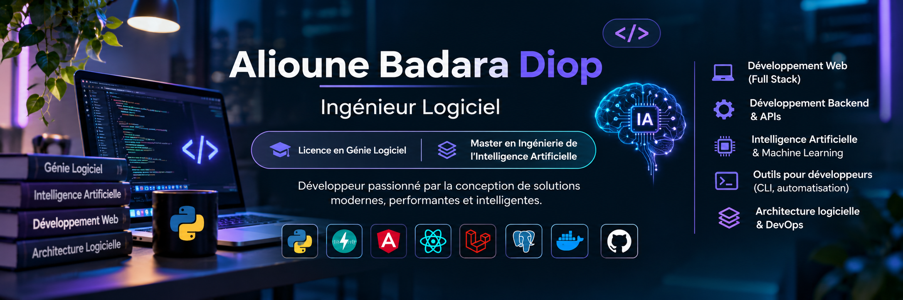

  

 👋 Bonjour, je suis Alioune Badara Diop

### 🎓 Ingénieur Logiciel | Master en Ingénierie de l'Intelligence Artificielle | Développeur Full Stack

Passionné par le développement logiciel, l'architecture informatique et les nouvelles technologies, je conçois des solutions modernes, performantes et évolutives.

Titulaire d'une **Licence en Génie Logiciel**, je poursuis actuellement un **Master en Ingénierie de l'Intelligence Artificielle (AI Engineering)**.

J'aime transformer des idées en applications concrètes, relever des défis techniques et développer des outils qui facilitent le travail des développeurs.

---

## 🚀 À propos de moi

- 🎓 Licence en Génie Logiciel.
- 🧠 Étudiant en Master d'Ingénierie de l'Intelligence Artificielle.
- 💻 Développement Backend et Full Stack.
- 🐍 Passionné par Python et son écosystème.
- ⚙️ Intérêt pour les API REST, les CLI et l'architecture logicielle.
- 🌍 Dakar, Sénégal.
- 🎯 Concevoir des solutions technologiques innovantes.

---

## 🛠️ Technologies et outils

### 💻 Langages de programmation

Langage C 
 . Python
 . Java
 . PhP
 . HTML5
 . CSS3
 . Javascript

### ⚙️ Backend et frameworks
FastApi
 . Django 
 . Flask
 . Laravel

### 🌐 Frontend

 . React
 . Angular

### 📱 Développement mobile

 . Flutter
 . React Native

### 🗄️ Bases de données

 . PostgreSQL
 . MySQL
 . Supabase
 . MongoDB

### 🔧 Outils de développement
 . Git
 . GitHub
 . VsCode
 . Docker

---

## 💡 Mes domaines d'intervention

- **Génie logiciel :** Analyse, conception, modélisation UML et développement.
- **Backend :** API REST, authentification et logique métier.
- **Frontend :** Interfaces web modernes et responsives.
- **Mobile :** Applications multiplateformes avec Flutter.
- **Bases de données :** Modélisation et gestion des données.
- **Developer Tools :** Création de CLI et automatisation.
- **Intelligence artificielle :** Machine Learning, LLM et applications intelligentes.

---

## 📌 Mes projets

### 🐍 Alioune CLI

Un outil développé en Python pour automatiser la création de projets FastAPI et améliorer la productivité des développeurs.

🔗 [Voir le projet sur GitHub](https://github.com/Aliounecode/alioune-cli)

### 💻 Sen Solution Informatique

Une plateforme web de vente de matériel informatique, d'accessoires et de services de dépannage.

---

## 🔒 Projets privés et démonstrations

Tous mes projets ne sont pas accessibles publiquement.

Une partie importante de mes réalisations concerne des **dépôts privés, des projets clients et des développements internes**, qui ne peuvent être partagés librement pour des raisons de confidentialité, de sécurité ou de propriété intellectuelle.

Je reste néanmoins disponible pour organiser :

- 🎥 Des démonstrations personnalisées.
- 💻 Des présentations techniques.
- ⚙️ Des explications sur les architectures et technologies utilisées.
- 🤝 Des échanges avec les recruteurs, entreprises et collaborateurs.

**Un projet privé ne signifie pas un projet invisible : une démonstration peut être organisée sur demande.**

---

## 🎯 Mes ambitions

Continuer à progresser en génie logiciel et en intelligence artificielle, participer à des projets ambitieux et développer des solutions technologiques innovantes.

---

## 🤝 Me contacter

- 💼 GitHub : [@Aliounecode](https://github.com/Aliounecode)
- 📧 E-mail : aliounediop723@gmail.com
- 🌍 Dakar, Sénégal.

---

\
   \<b>Construire aujourd'hui. Innover pour demain. 🚀\</b>   \    \<i>Génie logiciel × Développement × Intelligence artificielle\</i> \

